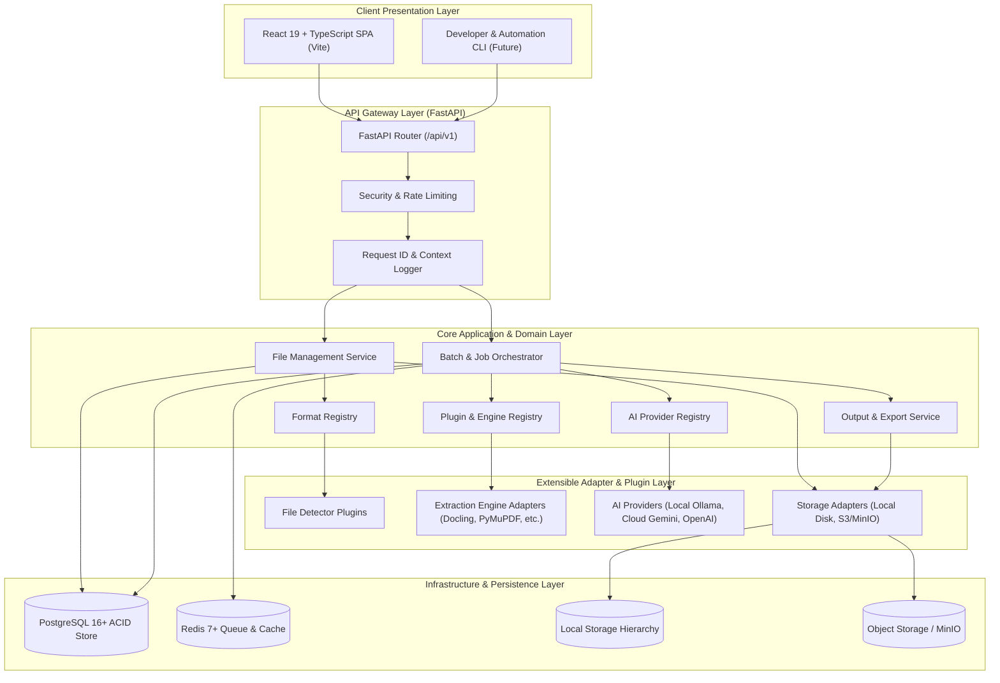

# DocuMind AI — System Architecture & Design Specification

**Current Phase:** Phase 2 (Universal File Detection Engine)  
**System Classification:** Universal File Intelligence Platform  
**Architecture Style:** Modular Monolith with Clean Architecture & Plugin Extensibility  

---

## 1. High-Level Architectural Overview

DocuMind AI is structured as a **Modular Monolith** designed for high throughput, clean separation of concerns, and future microservice extraction.



---

## 2. Clean Architecture & Dependency Direction

The codebase strictly adheres to **Dependency Inversion** and **Clean Architecture**:

```
+-------------------------------------------------------------+
|                     1. API / Presentation                   |
|           (FastAPI Routes, Pydantic Request/Response)       |
+-------------------------------------------------------------+
                              | depends on
                              v
+-------------------------------------------------------------+
|                     2. Application Layer                    |
|             (Use Cases, Business Services, Workflows)       |
+-------------------------------------------------------------+
                              | depends on
                              v
+-------------------------------------------------------------+
|                       3. Domain Layer                       |
|           (Core Entities, Enums, Value Objects, ABCs)        |
+-------------------------------------------------------------+
                              ^ implements
                              |
+-------------------------------------------------------------+
|                   4. Infrastructure Layer                   |
|        (SQLAlchemy ORM, Postgres, Redis, Storage, Plugins)  |
+-------------------------------------------------------------+
```

### Invariants:
1. **Domain Layer:** Pure Python, zero external framework dependencies (no SQLAlchemy models or FastAPI imports inside domain entities). Contains abstract interfaces (`interfaces/`).
2. **Application Layer:** Orchestrates business use cases by consuming domain interfaces.
3. **Infrastructure Layer:** Implements database persistence, file I/O, cache adapters, and external API calls.
4. **API Layer:** Handles HTTP serialization, status codes, and request parameter validation.

---

## 3. Core Bounded Contexts & Module Responsibilities

### 3.1 File Management (`backend/app/modules/files/`)
- Handles multipart uploads, chunked streaming, file hash calculation (SHA-256), and path sanitization.
- Manages file lifecycle states (`PENDING`, `STORED`, `PROCESSING`, `PROCESSED`, `ERROR`, `DELETED`).
- Enforces storage quotas, temporary scratchpad isolation, and retention policies.

### 3.2 Format Registry (`backend/app/modules/formats/`)
- Maintains a registry of supported MIME types, file extensions, magic signatures, and format categories (Document, Spreadsheet, Presentation, Image, Audio, Video, Archive, Code, Structured Data).
- Delegates detection to `FileDetectorInterface` implementations.

### 3.3 Processing Orchestrator (`backend/app/modules/batches/`)
- Manages high-volume batch creation, file job scheduling, and worker dispatch.
- Coordinates between extraction plugins, AI enhancement, and output formatting.

### 3.4 Extraction Adapter Registry (`backend/app/plugins/`)
- Discovers and verifies extraction engine plugins against explicit interfaces.
- Provides health checks, hardware capability checks (CPU/GPU), and dependency verification.

### 3.5 AI Provider Registry (`backend/app/modules/ai/`)
- Abstracts inference providers behind `AIProviderInterface`.
- Default mode is **Local** (e.g. Ollama, ONNX, CPU fallback).
- Cloud providers are strictly disabled by default and require explicit credentials and user consent.

### 3.6 Output Management (`backend/app/modules/exports/`)
- Formats structured extraction results into Markdown, JSON, plain text, or parquet.
- Writes generated assets to persistent storage and links them to database `extraction_records`.

---

## 4. High-Volume Batch Architecture (10,000+ Files Strategy)

To reliably process batches exceeding 10,000 files without memory exhaustion or database locks:

1. **Two-Tier Relational Hierarchy:**
   - **Parent `batches` record:** Holds aggregate counters (`total_files`, `completed_files`, `failed_files`) and status. Updated atomically via SQL `UPDATE batches SET completed_files = completed_files + 1 WHERE id = :id`.
   - **Child `document_jobs` records:** Individual records per file containing job state, attempt counts, execution error details, and timing logs.
2. **Durable State Machine:**
   - Job states: `QUEUED` -> `PROCESSING` -> `COMPLETED` | `FAILED` | `CANCELLED`.
   - All state transitions are committed to PostgreSQL, ensuring full recovery across node reboots or unexpected process termination.
3. **Idempotent Job Dispatch:**
   - Each job carries an idempotency token (`batch_id + file_id + engine`). Re-executing a job does not create duplicate database records.
4. **Queue Separation (CPU vs. GPU):**
   - High-throughput lightweight tasks (PDF text extraction, CSV parsing) run on CPU worker pools.
   - Resource-intensive AI tasks (vision models, deep layout analysis, Whisper audio) route to dedicated GPU or throttled local queues.
5. **Backoff and Retry Policy:**
   - Configurable exponential backoff with jitter for transient failures (e.g. temporary I/O locks, memory pressure). Max retries capped per job.

---

## 5. Microservice Extraction Roadmap

While DocuMind AI begins as a clean Modular Monolith, its interfaces are pre-architected for extraction:

```
[Phase 1-2] Modular Monolith (Single Process / Worker Threads)
      │
      ▼
[Phase 3-4] Split Heavy Workers (FastAPI Gateway + Celery/Redis Extraction Workers)
      │
      ▼
[Phase 5+] Dedicated Microservices:
      ├── Gateway & File Service (FastAPI)
      ├── Deep Document Extraction Service (Docling/MinerU GPU Container)
      ├── Audio/Video Processing Service (Whisper/FFmpeg Container)
      └── AI Orchestration & Embedding Service
```
