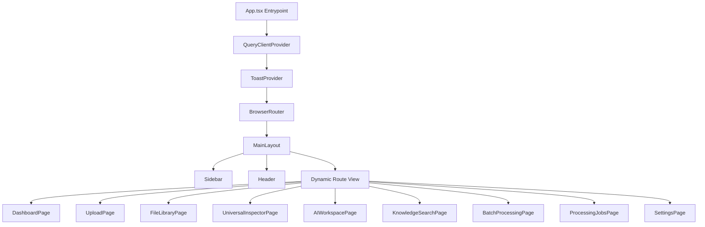

# DocuMind AI — Phase 13 Frontend Architecture

## 1. Architecture Overview

The DocuMind AI web client is built on modern web standards utilizing **React 18**, **TypeScript 5**, **Vite 5**, **Tailwind CSS v4**, and **TanStack Query v5**. It interfaces with the FastAPI backend through a unified REST API layer.

---

## 2. State Management & Server Synchronization

### 2.1 Server State: TanStack Query v5
Server-derived state is managed entirely through TanStack Query, offering automatic deduplication, background caching, and periodic polling:
- `["dashboardAnalytics"]`: Aggregated system metrics (polled every 30s or on-demand).
- `["files", category, status, search]`: Paginated and filtered library file items.
- `["fileExtraction", fileId]`: Document, spreadsheet, presentation, image, audio, or video extraction details.
- `["fileIndexStatus", fileId]`: AI vector indexing status.
- `["jobs", status, stage]`: Active execution queue and worker telemetry (polled every 5s).
- `["systemStatus"]`, `["systemCapacity"]`, `["queueStatus"]`: Real-time hardware worker allocation and backpressure status.

### 2.2 Client State: Zustand
Global UI preferences are persisted in local storage via Zustand:
- Theme: `light` vs `dark`.
- Sidebar: Expanded vs collapsed state (`isSidebarCollapsed`).
- Mobile Navigation: Drawer visibility state (`isMobileSidebarOpen`).

### 2.3 Transient State: Context API
Notification toasts are orchestrated via `ToastContext`, providing isolated lifecycle management without re-rendering parent component trees.

---

## 3. Routing Architecture

Routes are defined declaratively in `frontend/src/app/App.tsx`:

| Path | Component | Description |
|---|---|---|
| `/` | `DashboardPage` | Executive system summary, recent files, batches, format distributions |
| `/upload` | `UploadPage` | Universal drag-and-drop gateway, folder ingestion, dedup alerts |
| `/files` | `FileLibraryPage` | Complete file library with filters, grid/list view, deletion, inspector |
| `/inspector/:fileId` | `UniversalInspectorPage` | Full-page adaptive inspector for any format |
| `/ai` | `AIWorkspacePage` | Conversational RAG workspace with multi-model provider selector |
| `/search` | `KnowledgeSearchPage` | Reciprocal Rank Fusion hybrid search across library |
| `/bulk-processing` | `BatchProcessingPage` | Large-scale multi-file pipeline management |
| `/jobs` | `ProcessingJobsPage` | Real-time queue depths, task execution logs, retry controls |
| `/system` | `SystemStatusPage` | Hardware, worker, and queue health diagnostics |
| `/settings` | `SettingsPage` | Multi-tab configuration (AI, Hardware, Storage, Privacy) |

---

## 4. API Client Strategy (`frontend/src/services/api.ts`)

All backend HTTP communication flows through a typed request wrapper:
- Automatic JSON serialization and header resolution.
- Standardized error transformation (`Error(message || status)`).
- Full endpoint coverage across all 13 phases.
- Binary asset and download URL helpers (`getFileDownloadUrl`, `streamVideoUrl`).

---

## 5. Performance & Build Profile

The application utilizes Vite's Rollup pipeline to compile and bundle production assets:
- **Total CSS footprint**: 64.47 kB (gzip: 10.71 kB) with zero runtime style overhead.
- **Production JS bundle**: 616.85 kB (gzip: 149.44 kB) covering all 10 specialized intelligence engine visualizers.
- **Transpile speed**: Complete build under 2.3 seconds with full TypeScript type verification (`tsc -b`).
