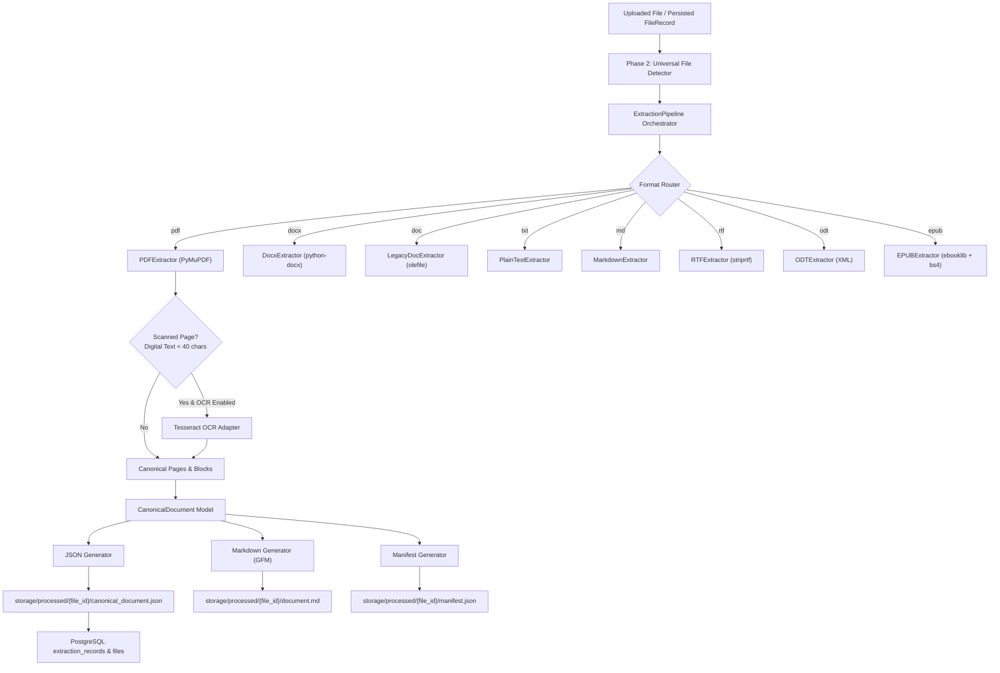

# DocuMind AI — Phase 3: Document Content Extraction Engine

## Overview

DocuMind AI Phase 3 implements a robust, modular, production-ready **Document Content Extraction Engine**. The engine accepts files identified by the Universal File Detection Engine (Phase 2), parses internal structural representations, and normalizes them into a unified **Canonical Document Schema** (`CanonicalDocument`).

Content extraction preserves:
- Hierarchical structure (headings levels 1–6, sections, paragraphs)
- Document page dimensions, rotation, and sequence
- 2D Bounding box coordinates `[x0, y0, x1, y1]` for native PDF blocks
- Natural reading order
- Structured tabular data (rows, columns, markdown tables)
- Embedded headers and footers
- Hyperlinks and document-level metadata (author, title, creation/modification dates)
- Zero hallucination policy: raw original extracted text is preserved verbatim without synthesis or generative rewriting.

---

## Supported Formats & Engines

| Format | Format ID | MIME Type | Extraction Adapter | Primary Engine / Parser | Features Extracted |
|---|---|---|---|---|---|
| **PDF** | `pdf` | `application/pdf` | `PDFExtractor` | PyMuPDF (fitz) | Text blocks, bounding boxes, page dimensions, `find_tables()`, scanned page detection, OCR routing, encrypted PDF detection, metadata |
| **DOCX** | `docx` | `application/vnd.openxmlformats-officedocument.wordprocessingml.document` | `DocxExtractor` | `python-docx` | Headings 1–6, paragraphs, numbered/bulleted lists, tables, headers, footers, hyperlinks, core properties |
| **DOC** | `doc` | `application/msword` | `LegacyDocExtractor` | `olefile` / Pure-Python OLE2 | OLE Summary streams, WordDocument text streams, UTF-16LE / ASCII text runs, macro execution disabled |
| **TXT** | `txt` | `text/plain` | `PlainTextExtractor` | Native / Standard Library | BOM detection (UTF-8, UTF-16, UTF-32), UTF-8, Windows-1252, ISO-8859-1 fallback, paragraph chunking |
| **Markdown** | `md` | `text/markdown` | `MarkdownExtractor` | Native / PyYAML | YAML frontmatter, headings 1–6, code blocks with language identifiers, GFM tables, list items, blockquotes |
| **RTF** | `rtf` | `application/rtf` | `RTFExtractor` | `striprtf` | Formatted text stripping, paragraphs, headings, character counts |
| **ODT** | `odt` | `application/vnd.oasis.opendocument.text` | `ODTExtractor` | `xml.etree.ElementTree` / `zipfile` | XML text body, `text:h` headings, `text:p` paragraphs, `text:list` items, `table:table` grids, metadata |
| **EPUB** | `epub` | `application/epub+zip` | `EPUBExtractor` | `ebooklib` + `BeautifulSoup4` | Dublin Core metadata, spine reading order, chapter separation, headings, paragraphs, lists, tables, embedded images |

---

## Architecture Components

---

## REST API Endpoints

1. `POST /api/v1/files/{file_id}/extract`: Synchronously triggers document content extraction, stores generated artifacts, and returns `ExtractionManifest`.
2. `GET /api/v1/files/{file_id}/extraction`: Returns latest extraction status, engine metadata, page count, and output artifact paths.
3. `GET /api/v1/files/{file_id}/extraction/result`: Returns full canonical JSON (`CanonicalDocument`).
4. `GET /api/v1/files/{file_id}/extraction/markdown`: Returns generated GitHub Flavored Markdown (`?raw=true` returns `text/markdown`).
5. `GET /api/v1/files/{file_id}/extraction/manifest`: Returns execution manifest with diagnostics and asset inventory.
6. `GET /api/v1/extraction/capabilities`: Lists supported formats, active engines, and OCR subsystem status.
